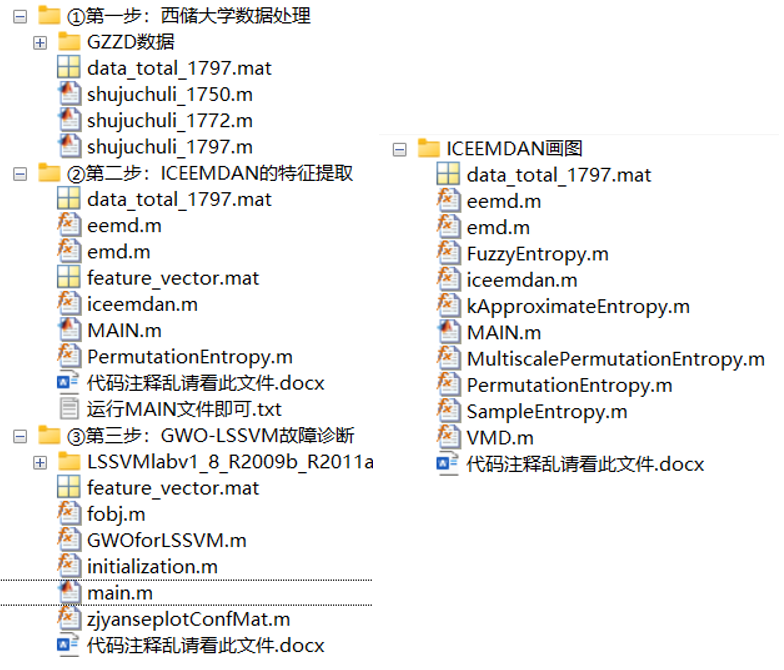
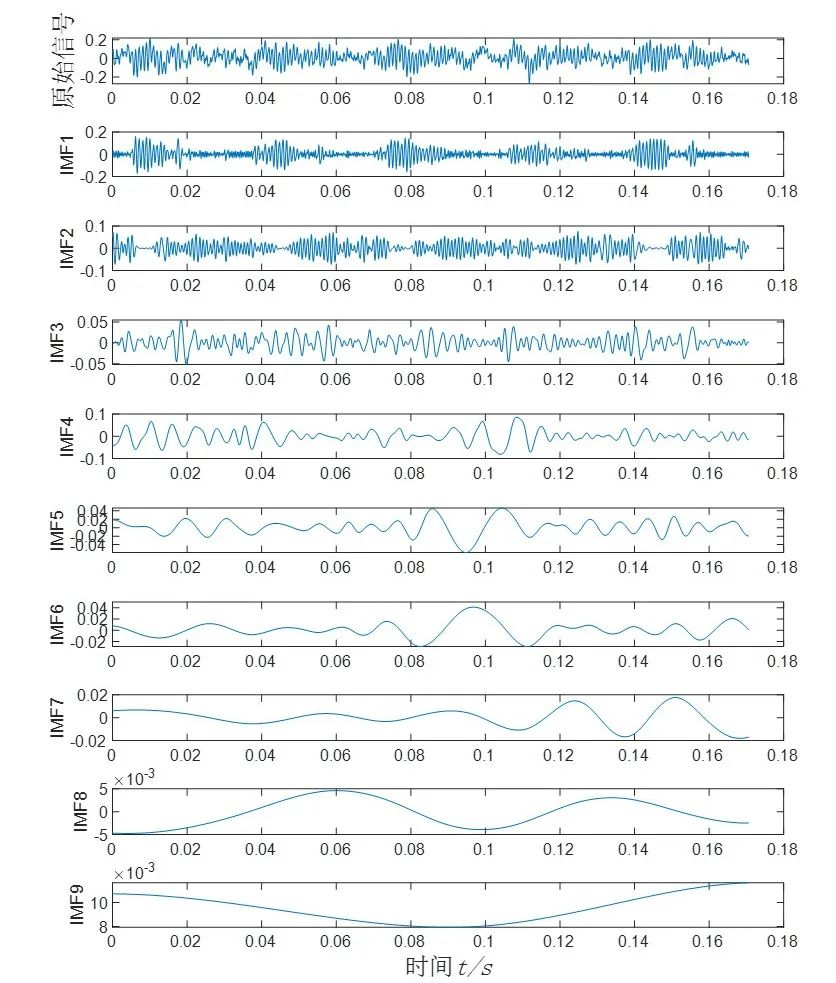
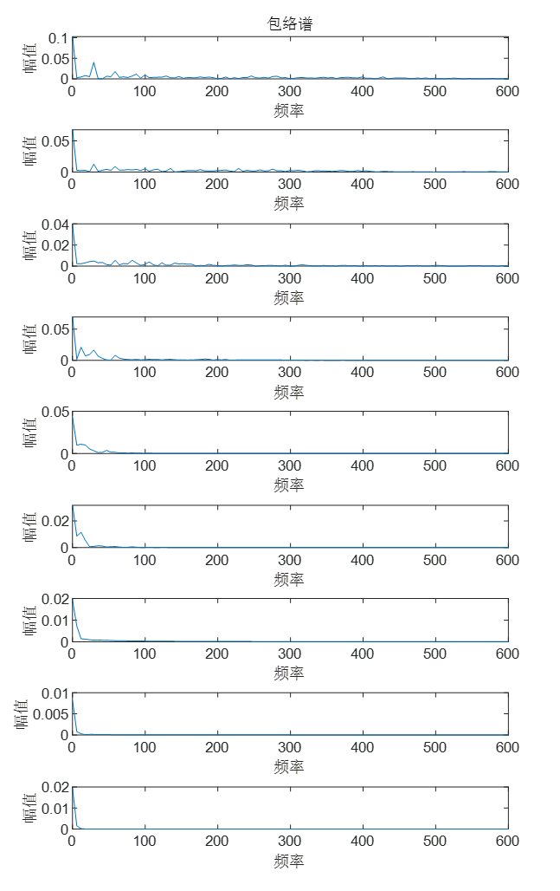
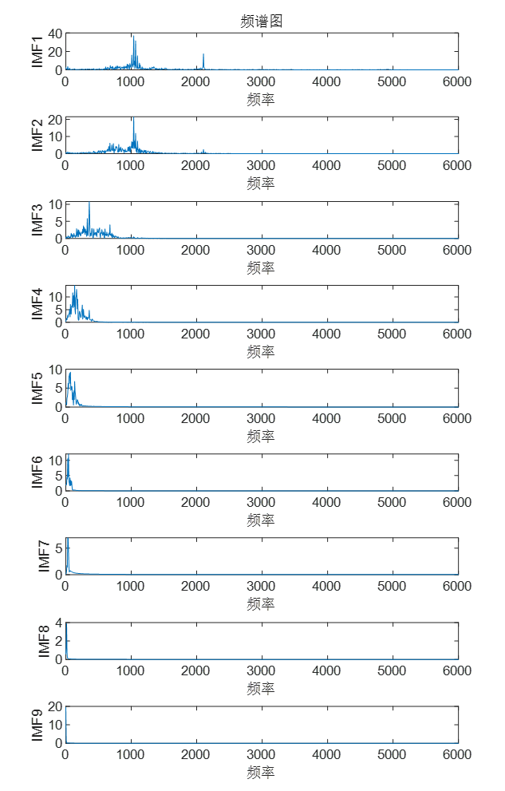
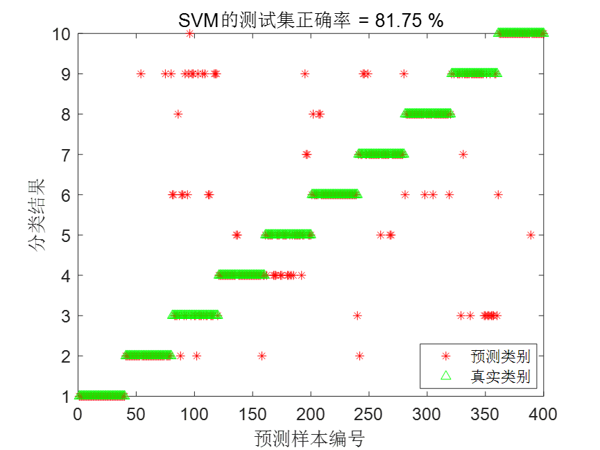
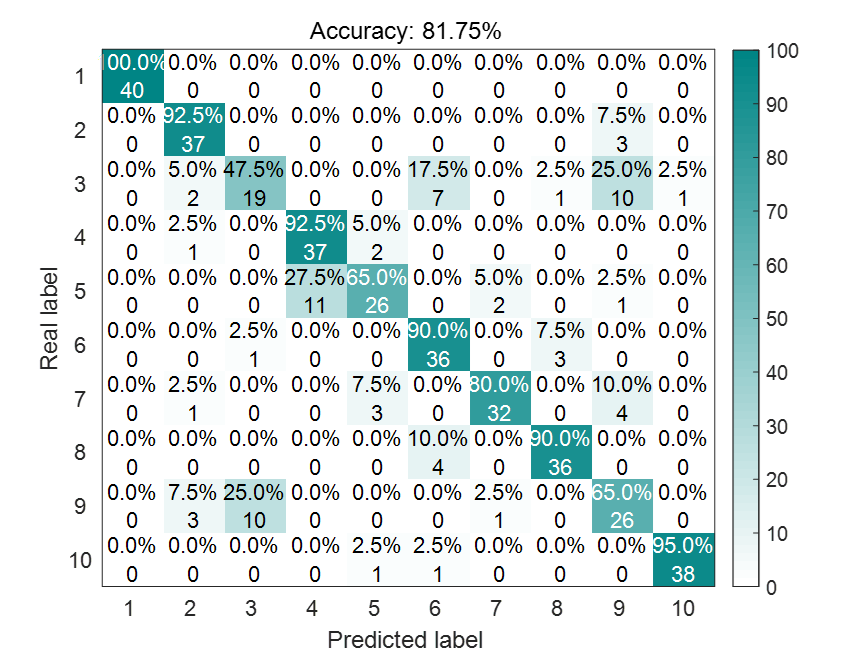
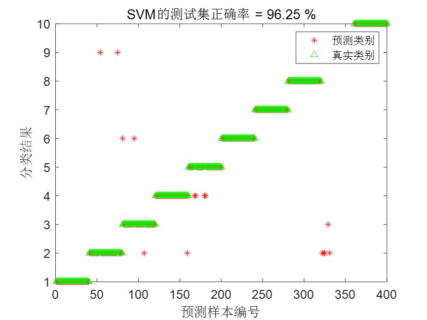
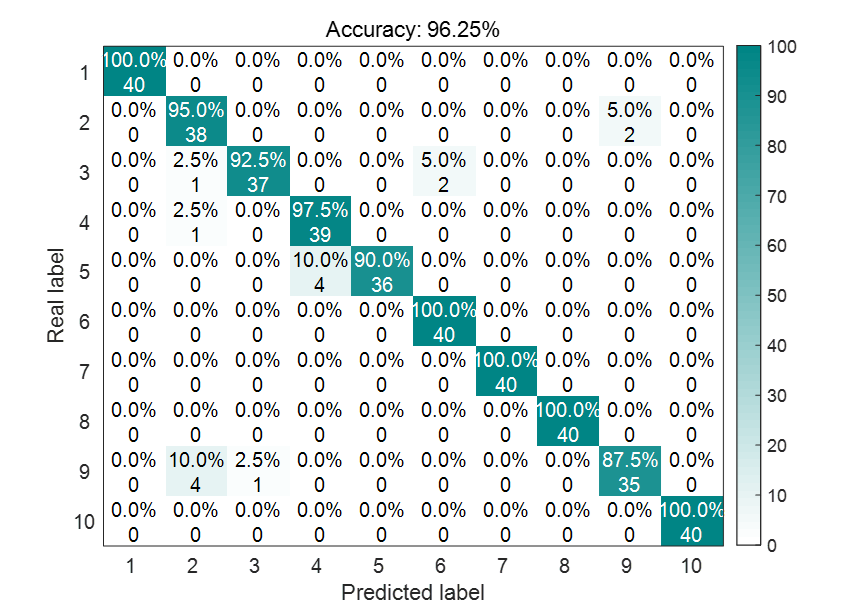
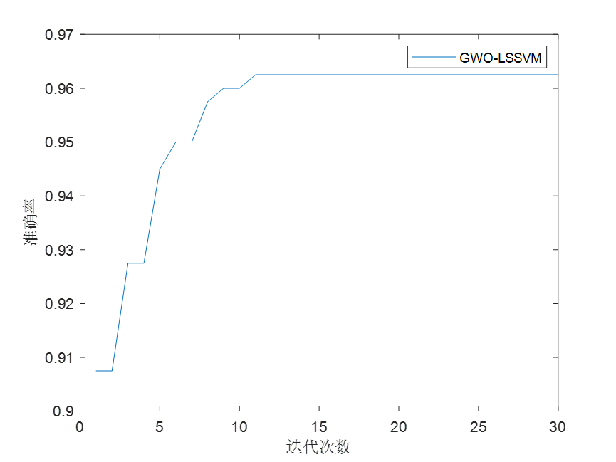

# ICEEMDAN-GWO-LSSVM bearing diagnosis at Xichu University, MATLAB code, MATLAB code

This time, we bring you a session on bearing diagnosis methods based on ICEEMDAN-GWO-LSSVM.
Code directory:
\n        \n  
Introduction
① Process the official downloaded data from Xi'an Jiaotong University.
② Use ICEEMDAN to decompose the data, obtaining several IMF components, calculate the permutation entropy of the first n IMF components, thereby constructing a feature vector. For this content, we select the first 8 components.
③ After normalizing the feature vector, divide it into training and testing sets, and feed them into LSSVM for diagnosis.
④ Optimize the two key parameters (σ2(sig2) and γ (gam)) of LSSVM using GWO grey wolf algorithm, improving the accuracy of bearing diagnosis.
Detailed Explanation
1. Process the official downloaded data from Xi'an Jiaotong University, following these steps:
Load a total of 10 types of data, then select DE_time (%DE is drive-side data, FE is fan-side data, BA is acceleration data, choose one of them).
2. Set the sliding window w, the number of fault sample points s for each data point, and the sample quantity m for each fault type.
After all data are slid through the window, combine them into a single data variable named data.
Previous articles have discussed the processing of Xi'an Jiaotong University bearing data, you can refer to this article: Xi'an Jiaotong University Bearing Diagnosis Data Processing, MATLAB Free Code Available.
Finally, the obtained data is a 1200*2048 matrix, where 1200 is the sample size, 2048 is the feature size. 1200 equals 120*10, 10 refers to 10 types of fault states, and 120 refers to each state has 120 samples. In the code, it is data_total_1797.mat.
2. Use ICEEMDAN to decompose the Xi'an Jiaotong University data.
ICEEMDAN decomposition diagram:
From the ICEEMDAN decomposition diagram, it can be seen that the main information of the bearing is contained in the first few IMF components. For this content, we select the first 8 IMF components. Calculate the permutation entropy of the first 8 IMF components to construct a feature vector.
Finally, we obtain a 1200×8 matrix, which is the feature vector! In the code, it is feature_vector.mat.
Additionally, the ICEEMDAN envelope spectrum is attached:
ICEEMDAN Spectrum:
III. Feed the constructed feature vectors into LSSVM for training
Feature vectors are normalized, with the first 80 groups used for training and the last 40 groups for testing. The results are as follows:
IV. Optimize LSSVM using GWO
Set the upper and lower limits of two key parameters (σ2(sig2) and γ (gam)) of LSSVM to:
[10^-3, 10^3]. Set the number of grey wolves to 30 and the iteration count to 50. After optimization, the diagnostic result of GWO-LSSVM is as follows:
It can be seen that compared to the unoptimized LSSVM, the diagnostic accuracy of GWO-LSSVM has greatly improved.
Part of the code:
Data Processing Code:
clc;\nclear;\naddpath(genpath(pwd));\n%DE is the data from the driver end, FE is the fan end data, and BA is the acceleration data. Choose one of them.\nload 97.mat     %Normal\nload 107.mat    % Diameter 0.007 inches, inner ring failure at 1750 RPM\nload 120.mat    % Diameter 0.007, Rolling Bear Fault at Rotational Speed of 1750\nload 132.mat    % Diameter 0.007, outer ring fault at 1750 RPM\nload 171.mat    % Diameter 0.014 inches, inner ring failure at 1750 RPM\nload 187.mat    % Diameter 0.014 inches, rolling element fault at 1750 RPM\nload 199.mat    % Diameter 0.014 inches, outer ring failure at 1750 RPM\nload 211.mat   % Diameter 0.021 inches, inner ring failure at 1750 RPM\nload 224.mat  % Diameter 0.021 inches, rolling element fault at 1750 RPM\nload 236.mat  % Diameter 0.021 inches, outer ring failure at 1750 RPM\nw=1000;                  % w is the size of the sliding window, 1000\ns=2048;                  % Each fault represents 2048 fault points\nm = 10;  % Each type of fault has 120 samples\nD0=[];\nfor i =1:m\n    D0 = [D0,X097_DE_time(1+w*(i-1):w*(i-1)+s)];\nend\nD0 = D0';\nICEEMDANCode for drawing:   
clc\nclear\nclose all\nload data_total_1797.mat\n​\nfs=12000;%Sampling frequency\nTs=1/fs;% Sampling period\nL=2048;% Number of sampling points\nt=(0:L-1)*Ts;% Time series\n​\n% Parameters related to the IC EMDAN\nNstd = 0.1;  % The signal-to-noise ratio is used to suppress aliasing effects. Noise weight (range: 0-inf, generally selected between 0 and 1)\nNR = 80;       %The number of noise additions, which should be performed 60 times. Generally, it is recommended to choose between 50-100.\nMaxIter = 8;  %Set the maximum number of components that can be decomposed within emd. This determines the maximum number of components (assuming ceemdan originally decomposes into 10 components, setting this value to 5 will result in 5 components; if set to 20, it will still decompose into 10 components)\n                   % This value is generally set to inf or a very large number. If you require ICEEMDAN to obtain only one component at a time, then this parameter can be set to 1.\n​\nX = data(1,:)'; % Here, you can choose DE (Drive Acceleration), FE (Fan Acceleration), or BA (Base Acceleration), directly change the variable name and select one.\n[u,its]=iceemdan(X,Nstd,NR,MaxIter,1);\nK = size(u,1);\nfigure(1);\nimfn=u;\nn=size(imfn,1);\nsubplot(n+1,1,1);\nplot(t,X); % Fault signal\nylabel('Original signal','fontsize',12,'fontname','Song Ti');\n​\nfor n1=1:n\n    subplot(n+1,1,n1+1);\n    plot(t,u(n1,:));% Output IMF components, a(:,n) represents the element of matrix a's nth column, u(n1,:) represents the row elements of matrix u's n1 rows\n    ylabel(['IMF' int2str(n1)]);%int2str(i) is a function that converts the numeric value i to a character after rounding it, and y-axis naming.\nend\nxlabel('Time\itt/s','fontsize',12,'fontname','Song typeface');\nFeature extraction code:   
clear\nclc\nNstd = 0.1;  % The signal-to-noise ratio is used to suppress aliasing effects. Noise weight (range: 0-inf, generally selected between 0 and 1)\nNR = 80;       %The number of noise additions, which should be performed 60 times. Generally, it is recommended to choose between 50-100.\nMaxIter = 8;  %Set the maximum number of components in the internal envelope of emd. If you split out 10 components originally, setting this value to 5 will result in 5 components; if you set it to 20, you will still get 10 components.\n               % This value is generally set to inf or a very large number. If you require ICEEMDAN to obtain only one component at a time, then this parameter can be set to 1.\n               % Entropy calculation is only performed for the first 8 IMF components during feature extraction, therefore, here it is set to 8.\nload data_total_1797.mat\n% Arrangement Entropy Parameter Settings\nM = 3;  % Embedding dimension\nT = 1;  % Delay time\nfeature_vector = []; % Ultimately, the feature vector\nfor i = 1:size(data,1)\n    i\n    [u,its]=iceemdan(data(i,:),Nstd,NR,MaxIter,1);\n    for j=1:8\n        [pe ,hist] = PermutationEntropy(u(j,:),M,T);\n        PE(1,j) = pe;\n    end\n    feature_vector = [feature_vector;PE];\nend\nsave feature_vector.mat feature_vector\n  

## Images

<!-- PAYMENT_BLOCK -->

## Get this dataset

- Payment link (Stripe): [Buy now](https://buy.stripe.com/3cs8yP7sY87d0vu9AB)
- Payment QR code: 

<!-- /PAYMENT_BLOCK -->
